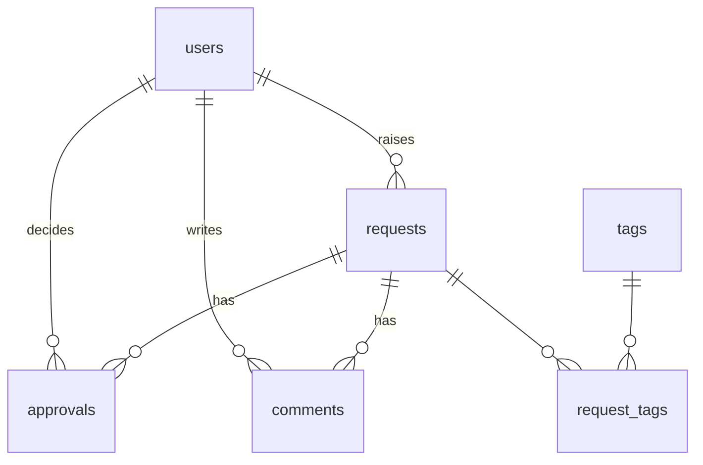

# Approvals Platform

[](https://github.com/RomulusMirauta/approvals-platform/actions/workflows/ci.yml)

**Live demo: [approvals-platform-eta.vercel.app](https://approvals-platform-eta.vercel.app)** · **API docs: [/docs](https://approvals-platform-eta.vercel.app/docs)** · sign in with a demo account (password `demo-password`): `bob@example.com` (approver), `alice@example.com` (requester), `carol@example.com` (admin). It's a shared demo, so others may have changed the data.

Human-in-the-loop approvals for AI agents. An agent (for example the [ERP Procurement MCP server](https://github.com/RomulusMirauta/erp-procurement-mcp)) finds an invoice that fails three-way matching and submits it here. A person reviews it in the dashboard and approves or rejects it, and the decision is recorded with a full audit trail.

## Screenshots

The approver's exception queue: invoices the ERP agent couldn't match, waiting for a person.


A request opened from the queue, with its exception codes, the decision form and the comment thread.


Sign-in, with one-click demo accounts for each role.


## Stack

- **API:** Node.js, Fastify 5, TypeScript, zod; versioned `/v1` REST routes; OpenAPI 3 generated from the same schemas that validate requests
- **Database:** Postgres with Drizzle ORM and SQL migrations. Locally and in tests it runs on [PGlite](https://pglite.dev), the Postgres engine compiled to WebAssembly, so no Docker is needed; in production, Neon
- **Auth:** JWT with roles: requester, approver, admin, agent
- **Dashboard:** React, Vite, TanStack Query
- **Shared contract:** `packages/contracts`, zod schemas used by both the API and the dashboard
- **Tests:** Vitest for the API and the dashboard; Playwright end-to-end tests in [`e2e/`](e2e)

## Data model



The rules live in the database as constraints: foreign keys with explicit `ON DELETE` behaviour, unique emails and tag names, a composite primary key on the `request_tags` join table, check constraints (an amount always has a currency; only decided requests have a decision time; a rejection needs a comment), and a partial unique index that allows only one pending request per source item, so an agent that retries can't create duplicates. See [apps/api/src/db/schema.ts](apps/api/src/db/schema.ts) and the generated SQL in [apps/api/drizzle](apps/api/drizzle).

## Testing

```bash
npm test                              # unit and API tests (Vitest)
npx playwright install chromium       # once, for the end-to-end tests
npm run test:e2e                      # Playwright: starts its own API and dashboard
npm run screenshots                   # regenerates the screenshots above
```

The end-to-end suite starts the real API on a fresh, seeded, in-memory Postgres (port 3100) and the dashboard's dev server (port 5174), so it never touches your local data. Tests use page objects and role- and label-based locators, create their own data through the API, and can run alone or in parallel.

## Deploy (Vercel + Neon)

One Vercel project serves both parts from the same domain: the dashboard as static files, and the API as a serverless function ([api/index.js](api/index.js) → [apps/api/src/serverless/handler.ts](apps/api/src/serverless/handler.ts)) in Frankfurt, next to the Neon database. See [vercel.json](vercel.json).

1. Create a Neon project in AWS Europe Central 1 (Frankfurt) and copy the **pooled** connection string.
2. Import this repository in Vercel and set two environment variables:
   - `DATABASE_URL`: the Neon connection string
   - `JWT_SECRET`: 32+ random characters, e.g. `node -e "console.log(require('crypto').randomBytes(32).toString('hex'))"`
3. Deploy. The build applies the migrations and adds the demo data if it isn't there yet. Requests never run migrations.
4. Optional: set `CRON_SECRET` (32+ random characters) and Vercel Cron resets the demo data every night at 03:00 UTC, so visitors always find a full queue.

## Roadmap

- [x] Monorepo, shared contract, database schema and migrations
- [x] API: auth, requests, decisions, comments, tags, OpenAPI docs
- [x] Dashboard: request list and filters, exception queue, approve/reject
- [x] ERP Procurement MCP server sends approval requests to this API
- [x] End-to-end tests with Playwright
- [x] Deploy (Vercel + Neon)
- [ ] Notification service consuming decision events from a queue

## License

[MIT](LICENSE)
