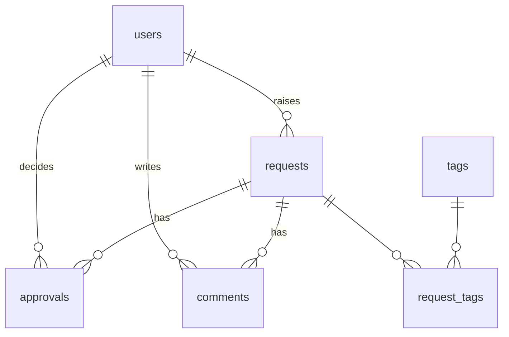

# Approvals Platform

> 🚧 In progress. The API and dashboard are being built in slices; see the roadmap below.

Human-in-the-loop approvals for AI agents. An agent (for example the [ERP Procurement MCP server](https://github.com/RomulusMirauta/erp-procurement-mcp)) finds an invoice that fails three-way matching and submits it here. A person reviews it in the dashboard and approves or rejects it, and the decision is recorded with a full audit trail.

## Stack

- **API:** Node.js, Fastify 5, TypeScript, zod; versioned `/v1` REST routes; OpenAPI 3 generated from the same schemas that validate requests
- **Database:** Postgres with Drizzle ORM and SQL migrations. Locally and in tests it runs on [PGlite](https://pglite.dev), the Postgres engine compiled to WebAssembly, so no Docker is needed; in production, Neon
- **Auth:** JWT with roles: requester, approver, admin, agent
- **Dashboard:** React, Vite, TanStack Query
- **Shared contract:** `packages/contracts`, zod schemas used by both the API and the dashboard

## Data model

The rules live in the database as constraints: foreign keys with explicit `ON DELETE` behaviour, unique emails and tag names, a composite primary key on the `request_tags` join table, check constraints (an amount always has a currency; only decided requests have a decision time; a rejection needs a comment), and a partial unique index that allows only one pending request per source item, so an agent that retries can't create duplicates. See [apps/api/src/db/schema.ts](apps/api/src/db/schema.ts) and the generated SQL in [apps/api/drizzle](apps/api/drizzle).

## Roadmap

- [x] Monorepo, shared contract, database schema and migrations
- [ ] API: auth, requests, decisions, comments, tags, OpenAPI docs
- [ ] Dashboard: request list and filters, exception queue, approve/reject
- [ ] ERP Procurement MCP server sends approval requests to this API
- [ ] End-to-end tests with Playwright, deploy (Vercel + Neon)
- [ ] Notification service consuming decision events from a queue

## License

[MIT](LICENSE)
