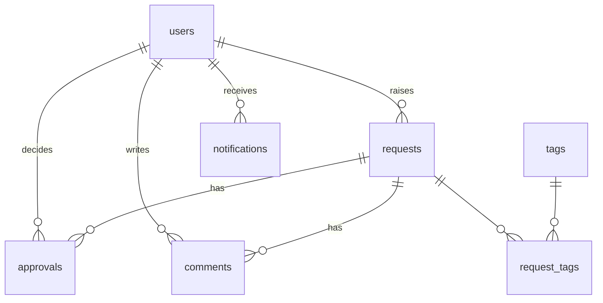

# Approvals Platform

[](https://github.com/RomulusMirauta/approvals-platform/actions/workflows/ci.yml)

**Live demo: [approvals-platform-eta.vercel.app](https://approvals-platform-eta.vercel.app)** · **API docs: [/docs](https://approvals-platform-eta.vercel.app/docs)** · sign in with a demo account (password `demo-password`): `bob@example.com` (approver), `alice@example.com` (requester), `carol@example.com` (admin). It's a shared demo, so others may have changed the data.

Human-in-the-loop approvals for AI agents. An agent (for example the [ERP Procurement MCP server](https://github.com/RomulusMirauta/erp-procurement-mcp)) finds an invoice that fails three-way matching and submits it here. A person reviews it in the dashboard and approves or rejects it, and the decision is recorded with a full audit trail.

## Screenshots

The approver's exception queue: invoices the ERP agent couldn't match, waiting for a person.


A request opened from the queue, with its exception codes, the decision form and the comment thread.


Sign-in, with one-click demo accounts for each role.


## Stack

- **API:** Node.js, Fastify 5, TypeScript, zod; versioned `/v1` REST routes; OpenAPI 3 generated from the same schemas that validate requests
- **Database:** Postgres with Drizzle ORM and SQL migrations. Locally and in tests it runs on [PGlite](https://pglite.dev), the Postgres engine compiled to WebAssembly, so no Docker is needed; in production, Neon
- **Auth:** JWT with roles: requester, approver, admin, agent
- **Dashboard:** React, Vite, TanStack Query
- **Shared contract:** `packages/contracts`, zod schemas used by both the API and the dashboard
- **Notification service:** [`services/notifications`](services/notifications), a worker that consumes events from a Postgres-backed queue (see below)
- **Tests:** Vitest for the API and the dashboard; Playwright end-to-end tests in [`e2e/`](e2e)

## Data model



The rules live in the database as constraints: foreign keys with explicit `ON DELETE` behaviour, unique emails and tag names, a composite primary key on the `request_tags` join table, check constraints (an amount always has a currency; only decided requests have a decision time; a rejection needs a comment), and a partial unique index that allows only one pending request per source item, so an agent that retries can't create duplicates. See [apps/api/src/db/schema.ts](apps/api/src/db/schema.ts) and the generated SQL in [apps/api/drizzle](apps/api/drizzle).

## Events and notifications

When a request is created, approved, rejected or cancelled, the API writes an event to the `outbox_events` table **in the same transaction** as the change (the transactional outbox). So the event exists if and only if the change committed: there is no window where the database says "approved" but the event was lost, or the other way round. A separate notification service, [`services/notifications`](services/notifications), consumes the table as a queue. It tells the requester about decisions on their request and tells approvers about new invoice exceptions and high-priority requests, and it can forward every event to a webhook (`NOTIFY_WEBHOOK_URL`).

```mermaid
sequenceDiagram
  participant Approver
  participant API
  participant DB as Postgres
  participant Worker as Notification service
  participant Hook as Webhook (optional)
  Approver->>API: POST /v1/requests/:id/decision
  API->>DB: BEGIN; update request; insert approval; insert outbox event; COMMIT
  API-->>Approver: 200
  loop every 2 s
    Worker->>DB: BEGIN; SELECT … FOR UPDATE SKIP LOCKED (a batch of due events)
    Worker->>DB: insert notifications (unique per event and recipient)
    Worker->>Hook: POST event (Idempotency-Key: event id, 5 s timeout)
    Worker->>DB: set processed_at, or attempts+1, last_error, available_at = now() + backoff; COMMIT
  end
  Note over API,DB: Later: GET /v1/notifications reads them through the API
```

- **Why the worker is a separate service:** it scales and fails independently of the API (if it is down, events wait in the table and nothing is lost), and it talks to the API only through the outbox. Reading notifications goes through the API (`GET /v1/notifications`, `POST /v1/notifications/:id/read`), so authentication and "you only see your own" stay in one place.
- **Why Postgres and not a broker:** the outbox must live in the same database as the data to be written atomically, and with `FOR UPDATE SKIP LOCKED` that same table is already a correct work queue: several workers each claim different rows, and a crashed worker's transaction rolls back so its events are retried. No Redis or RabbitMQ to run, and at this volume Postgres is plenty.
- **Delivery is at-least-once**, so it is idempotent: a unique `(event_id, recipient_id)` makes a repeated event a no-op, and the webhook gets the event id as an idempotency key. A failed delivery is retried with exponential backoff (10 s, 20 s, 40 s, …); after 5 attempts the event is dead-lettered (left unprocessed with its `last_error`). An event that doesn't match the shared contract in `packages/contracts` fails the same way.
- **Moving to a broker later:** keep the outbox and add a relay that publishes each row to SQS, RabbitMQ or BullMQ and marks it processed. The consumer stays the same `deliver` function; the broker replaces `SKIP LOCKED` (visibility timeout, acks), `available_at` (delayed retries) and the attempts limit (a dead-letter queue).
- **How the service reaches the database:** `@approvals/api` exports its database client and schema (`@approvals/api/db/*`), so there is one schema and one migration history, owned by the API. Sharing a database couples the two services' schemas; it is the simple choice for a modular monolith, and the table is the only interface between them.

Run the worker against the same Postgres as the API (PGlite runs inside a single process, so it can't be shared):

```bash
DATABASE_URL=postgres://... npm run worker -w @approvals/notifications
```

It stops cleanly on Ctrl+C or SIGTERM after finishing its current batch. A cron job or serverless function can call `drainOnce(db)` from `@approvals/notifications` instead.

## Testing

```bash
npm test                              # unit and API tests (Vitest)
npx playwright install chromium       # once, for the end-to-end tests
npm run test:e2e                      # Playwright: starts its own API and dashboard
npm run screenshots                   # regenerates the screenshots above
```

The end-to-end suite starts the real API on a fresh, seeded, in-memory Postgres (port 3100) and the dashboard's dev server (port 5174), so it never touches your local data. Tests use page objects and role- and label-based locators, create their own data through the API, and can run alone or in parallel.

## Deploy (Vercel + Neon)

One Vercel project serves both parts from the same domain: the dashboard as static files, and the API as a serverless function ([api/index.js](api/index.js) → [apps/api/src/serverless/handler.ts](apps/api/src/serverless/handler.ts)) in Frankfurt, next to the Neon database. See [vercel.json](vercel.json).

1. Create a Neon project in AWS Europe Central 1 (Frankfurt) and copy the **pooled** connection string.
2. Import this repository in Vercel and set two environment variables:
   - `DATABASE_URL`: the Neon connection string
   - `JWT_SECRET`: 32+ random characters, e.g. `node -e "console.log(require('crypto').randomBytes(32).toString('hex'))"`
3. Deploy. The build applies the migrations and adds the demo data if it isn't there yet. Requests never run migrations.

## Roadmap

- [x] Monorepo, shared contract, database schema and migrations
- [x] API: auth, requests, decisions, comments, tags, OpenAPI docs
- [x] Dashboard: request list and filters, exception queue, approve/reject
- [x] ERP Procurement MCP server sends approval requests to this API
- [x] End-to-end tests with Playwright
- [x] Deploy (Vercel + Neon)
- [x] Notification service consuming decision events from a queue

## License

[MIT](LICENSE)
